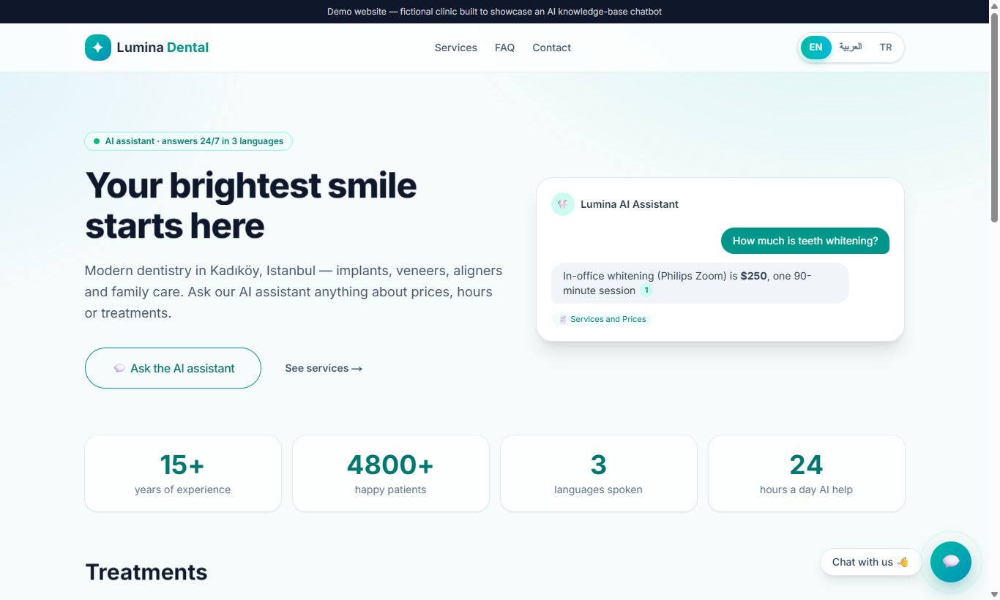
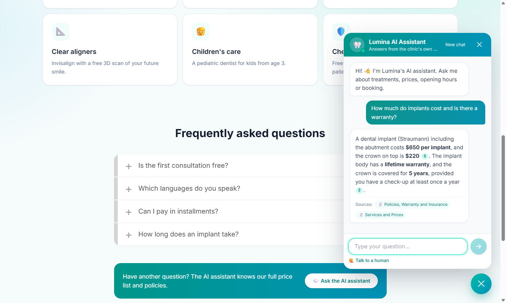
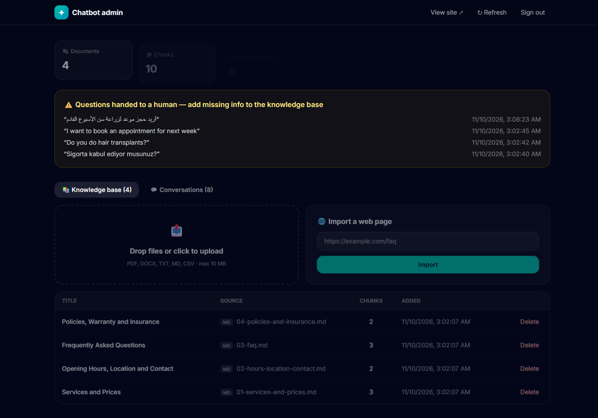

# AI Knowledge-Base Chatbot (RAG) — answers customers from your own documents

A production-style **Retrieval-Augmented Generation** chatbot for small businesses. Upload your PDFs, price lists, FAQs or web pages, and the bot answers website visitors **only from that content**, with **source citations**, in **English, Arabic and Turkish**. When it can't help, or the visitor wants to book, it hands the conversation to a human and emails the team.

Demo business: *Lumina Dental Studio*, a **fictional** clinic in Istanbul.



| Chat with cited sources | Admin dashboard |
|---|---|
|  |  |

## The problem
Clinics, agencies and shops answer the same questions all day (prices, hours, insurance, booking) and lose leads at night and on weekends. Generic chatbots make things up.

## The solution
- **Grounded answers.** Hybrid retrieval (pgvector semantic search + Postgres full-text, fused with Reciprocal Rank Fusion) feeds Claude only the relevant passages. The model must cite them, e.g. `[1]`, and says "I don't know" instead of inventing.
- **Multilingual.** A local multilingual embedding model lets an Arabic or Turkish question match English documents. The answer comes back in the visitor's language.
- **Streaming UX.** Answers stream over Server-Sent Events, with typing indicator, suggested questions, citation chips and source badges.
- **Human hand-off.** Booking requests, personal cases or unknown answers open a contact form. The lead is sent to an n8n webhook ([AI Lead Agent](https://github.com/m07adee/ai-lead-agent-n8n)), which scores it and emails the owner.
- **Admin dashboard.**
  - Drag-and-drop upload of PDF, DOCX, TXT, MD or CSV, plus import from a URL.
  - Delete documents.
  - Live stats.
  - Full conversation transcripts.
  - A list of questions that needed a human, which shows what info to add to the knowledge base.
- **Embed anywhere.** Add one line to any website:
  ```html
  <script src="https://YOUR-DOMAIN/widget.js" data-lang="en" async></script>
  ```
- **Stays on topic.** A parallel gatekeeper call classifies every message as in-scope or off-topic (coding, calculators, poems, translation, trivia, prompt-injection, "ignore your instructions"…) and returns a fixed polite refusal without calling the answer model. A server-side guard also cuts off any reply that starts producing code. Tested against 8 jailbreak and off-topic attempts in 3 languages.
- **Gateway-proof prompting.** Instructions are sent in the user turn as well as in `system`, because some Anthropic-compatible gateways drop the system prompt.
- **Safety.**
  - The admin API is protected with a Bearer token (constant-time compare).
  - Per-IP rate limits, plus input and upload size limits.
  - Prompt-injection guard in the system prompt.
  - No HTML injection in rendered answers.
  - The API runs as a non-root user, and only `/api/*` and the static site are exposed.

## Architecture
```
Browser ──► Caddy (static Next.js site + /api proxy)
              └──► FastAPI ──► PostgreSQL + pgvector  (documents, chunks, conversations)
                      ├──► fastembed (multilingual MiniLM, runs locally — free)
                      ├──► Claude API (streaming, grounded answers)
                      └──► n8n webhook (human hand-off → scored lead → email)
```

## Tech stack
**Backend:** Python 3.12, FastAPI, Anthropic SDK (Claude Haiku 5.5), pgvector, psycopg 3, fastembed, pypdf, python-docx, BeautifulSoup

**Frontend:** Next.js (static export), React, Tailwind CSS 4, Framer Motion, [Vengeance UI](https://www.vengenceui.com/) (Stagger Text, Liquid Button, Animated Number, FAQ Accordion, Kinetic Loader)

**Infrastructure:** Docker Compose, Caddy, Cloudflare Tunnel

## Results (demo)
- Answers in about **2–3 seconds** with cited sources, in 3 languages.
- Off-topic questions such as "Do you do hair transplants?" are answered honestly and offered a hand-off, never invented.
- A new document uploaded in the dashboard is answerable **immediately**.

## Run it
```bash
cp .env.example .env        # add your Claude API key and an ADMIN_TOKEN
docker compose up -d --build
```
- Website and chat: http://localhost:8091
- Admin: http://localhost:8091/admin
- API docs: http://localhost:8091/api/docs

Public link (optional): `docker compose --profile public up -d`, then `docker compose logs tunnel`.

The demo knowledge base in [`knowledge/`](knowledge) is loaded automatically on first start.

## API
| Method | Path | Description |
|---|---|---|
| POST | `/api/chat` | `{message, lang, conversation_id?}`. SSE stream of `meta` (sources), `delta`, `done` (`handoff`) |
| POST | `/api/handoff` | Visitor contact details and a note, sent to the team via webhook |
| GET | `/api/admin/stats` | Counters and questions that needed a human |
| GET/POST/DELETE | `/api/admin/documents` | List, upload (multipart) or delete documents |
| POST | `/api/admin/documents/url` | Import a web page |
| GET | `/api/admin/conversations` | Recent conversations with transcripts |

## Easy extensions
- WhatsApp channel (Meta Cloud API or Twilio) using the same `/api/chat` logic
- Calendly or Google Calendar booking
- Per-client workspaces (multi-tenant)
- Re-ranking model
- Analytics charts

---
Built by **Mohammad Adeeb**, AI Automation & Full-Stack Developer.
